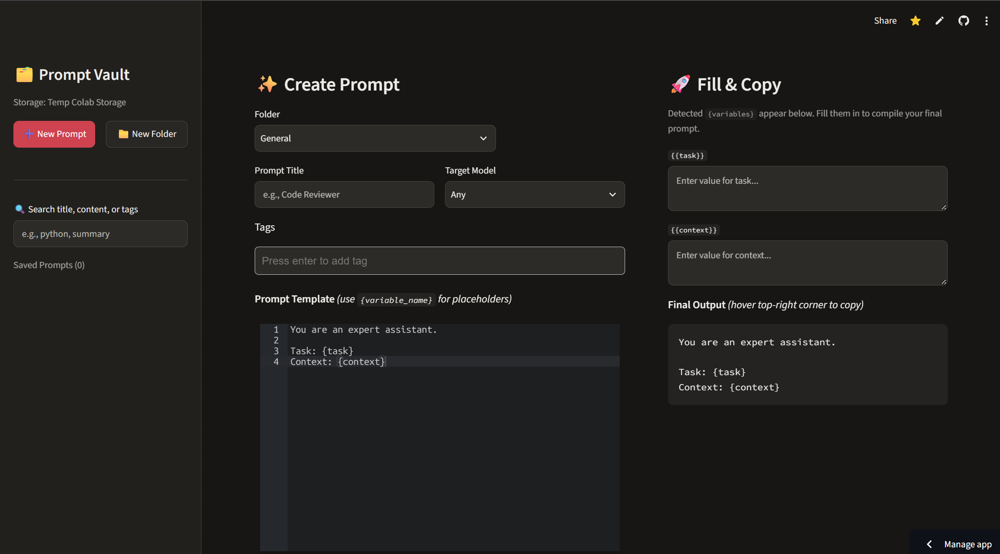

# 🗂️ Prompt Vault

**Prompt Vault** is a lightweight, local-first prompt management and testing system built with [Streamlit](https://streamlit.io/), SQLite, and Monaco Editor (`streamlit-ace`). It allows you to organize prompts into folders, manage metadata and tags, dynamically fill template variables in real time, and copy compiled prompts on the fly.

<br>

<p align="center">
  
</p>

---

## ✨ Features

- **📁 Folder Organization:** Group prompts into custom folders with quick folder creation and deletion.
- **✏️ Advanced Code Editing:** Built-in Monaco code editor (`streamlit-ace`) with dark theme (`tomorrow_night`) and markdown syntax highlighting.
- **🏷️ Flexible Tagging:** Categorize prompts with custom tags using `streamlit-tags`.
- **🚀 Dynamic Variable Injection:** Automatically detects `{variable_name}` placeholders in your templates and generates input fields to compile and copy prompts instantly.
- **💾 Persistent Storage:** Powered by SQLite (`prompts.db`), with seamless support for Google Drive persistence when run inside Google Colab, or local/cloud deployment.

---

## 🛠️ Tech Stack

- **Frontend / UI:** [Streamlit](https://streamlit.io/)
- **Code Editor:** [streamlit-ace](https://github.com/okld/streamlit-ace)
- **Tag Management:** [streamlit-tags](https://github.com/jrieke/streamlit-tags)
- **Data Handling:** Pandas & SQLite3

---

## 📦 Installation & Local Setup

1. **Clone the repository:**
```bash
git clone [https://github.com/Jewelzufo/prompt-vault.git](https://github.com/Jewelzufo/prompt-vault.git)
cd prompt-vault
```

2. **Install dependencies:**
```bash
pip install -r requirements.txt
```

3. **Run the application:**
```bash
streamlit run app.py
```

---

## 🚀 Deployment on Streamlit Community Cloud

1. Push your repository to GitHub (ensure `app.py` and `requirements.txt` are in the root directory).
2. Head over to [Streamlit Community Cloud](https://share.streamlit.io/).
3. Click **New app**, select your repository (`Jewelzufo/prompt-vault`), set the branch to `main`, and point the main file path to `app.py`.
4. Click **Deploy!**

---

## 📄 License

This project is open-source under the Apache-2.0 License.

```

<FollowUp label="Want me to also generate a matching requirements.txt file for your repository?" query="Can you generate the requirements.txt file for the Prompt Vault project?"/>

```
